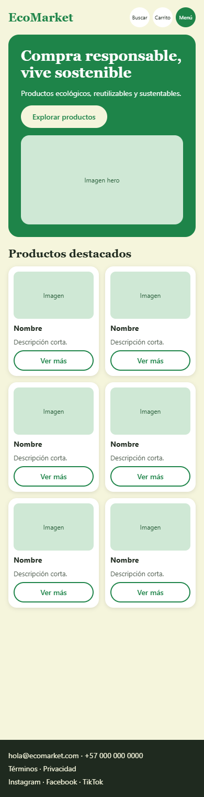
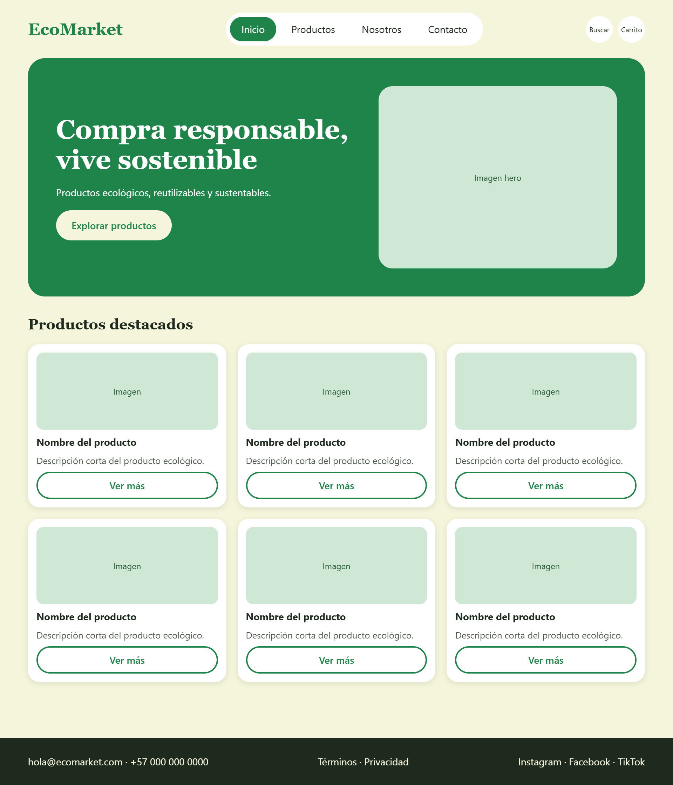
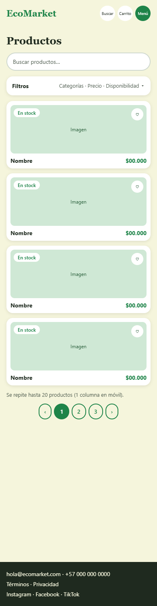
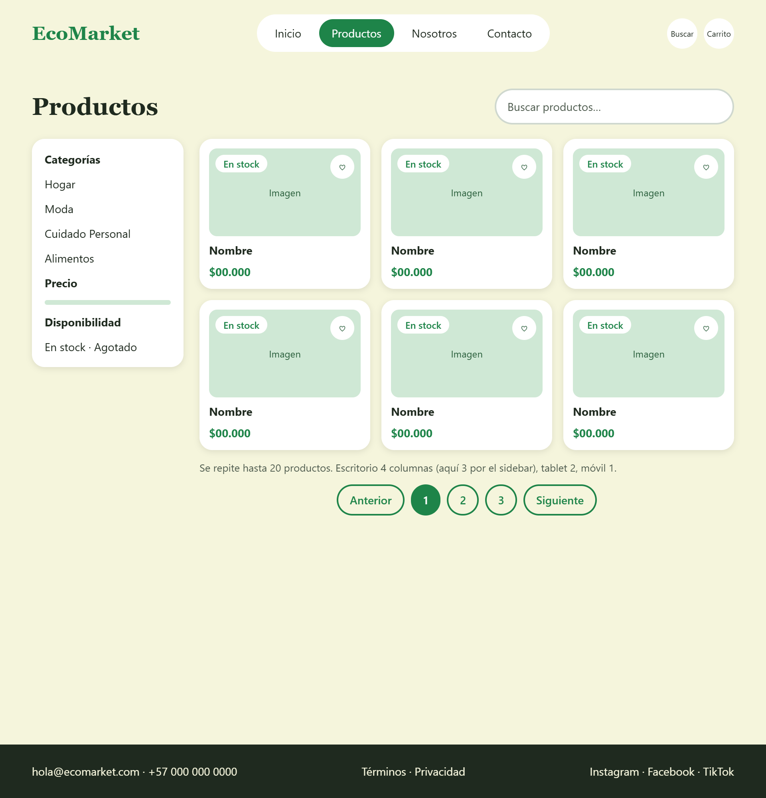
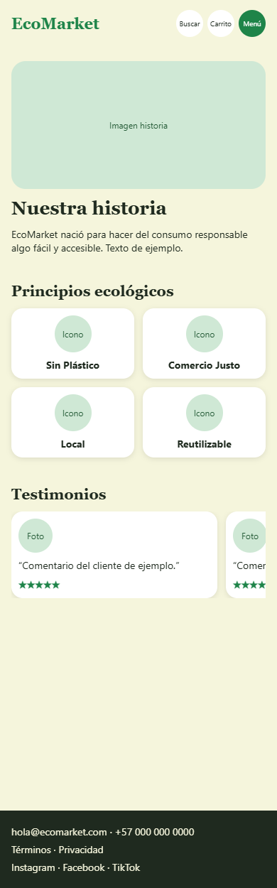
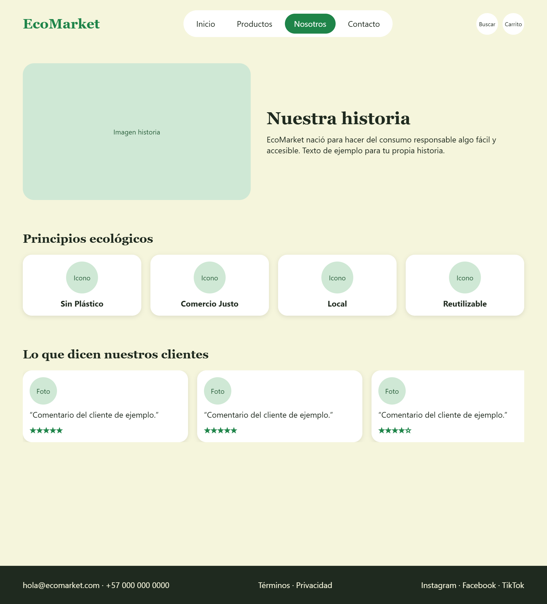
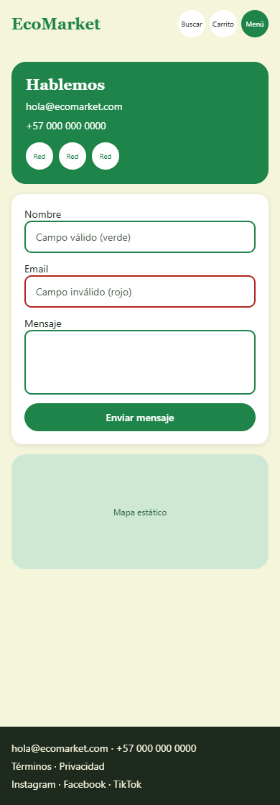
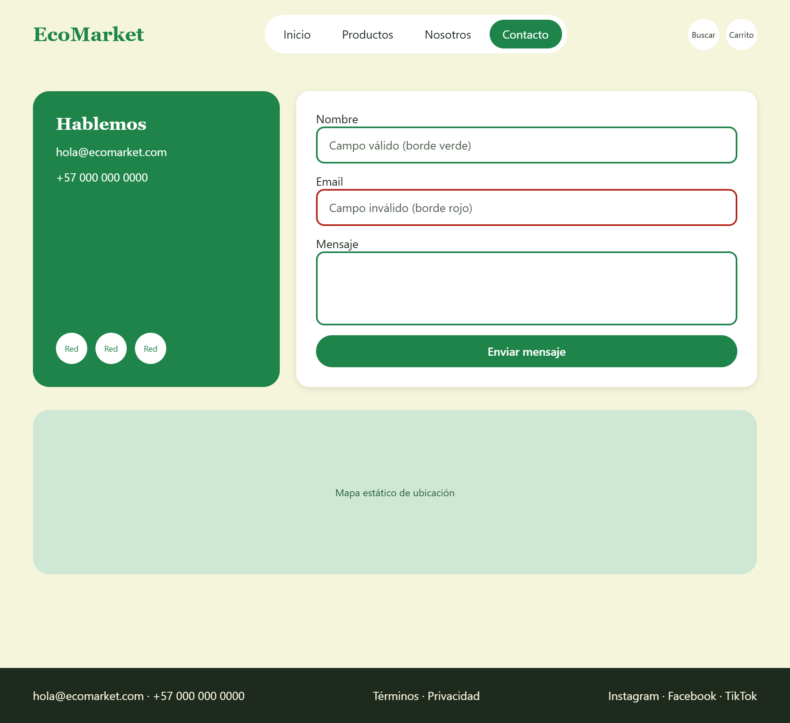
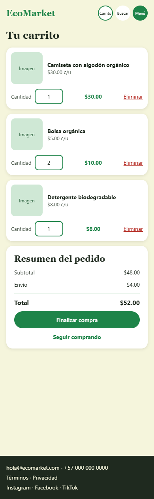
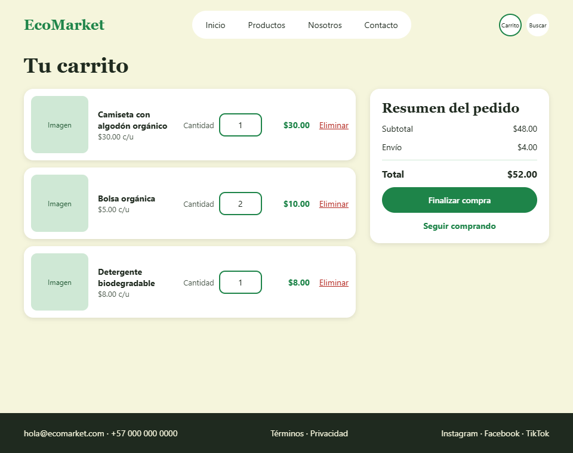

# EcoMarket

Tienda en línea de productos **ecológicos, reutilizables y sustentables**. El proyecto ofrece una plataforma accesible y atractiva donde los usuarios pueden explorar productos, conocer sus beneficios y realizar compras responsables.

Está maquetado únicamente con **HTML5 y CSS **: sin JavaScript y sin frameworks ni librerías externas. Toda la interactividad (menú, favoritos, validación, carrusel, paginación visual) se resuelve con CSS.

-  **Sitio en línea:** https://ecomarket-johynermartinez.netlify.app
-  **Repositorio:** https://github.com/johynerM/ecomarket.git

---

##  Capturas de pantalla

> Móvil: 390 px de ancho · Escritorio: 1440 px de ancho

| Vista | Móvil | Escritorio |
|---|---|---|
| **Inicio** |  |  |
| **Productos** |  |  |
| **Sobre nosotros** |  |  |
| **Contacto** |  |  |
| **Carrito** |  |  |

---

##  Vistas del proyecto

| Vista | Archivo | Qué incluye |
|---|---|---|
| **Inicio** | `index.html` | Encabezado con logo, menú y accesos (carrito y búsqueda); banner principal ; grid de 6 productos destacados con efecto hover que eleva la tarjeta; pie de página. |
| **Productos** | `views/productos.html` | Sidebar de filtros fijo (*sticky*) con categorías, rango de precios y disponibilidad; buscador visual; grid de 20 productos (4 → 2 → 1 columnas); etiqueta de stock o agotado; botón de favoritos; paginación visual. |
| **Sobre nosotros** | `views/sobre-nosotros.html` | Historia con imagen y texto (Flexbox); principios ecológicos con íconos; carrusel automático de reseñas con puntos indicadores. |
| **Contacto** | `views/contacto.html` | Formulario con validación visual (verde/rojo); mapa de ubicación; redes sociales con animación `scale`. |
| **Carrito** *(extra)* | `views/carrito.html` | Lista de artículos, resumen del pedido fijo en escritorio y eliminación de artículos con `:target`. |

---

##  Cómo visualizar el proyecto

**Opción 1: en línea.** Abre el sitio desplegado: https://ecomarket-johynermartinez.netlify.app

**Opción 2: en tu computador.**

```bash
git clone https://github.com/johynerM/EcoMarket_NombreApellido.git
cd EcoMarket_NombreApellido
```

Después abre `index.html` en tu navegador (doble clic) o, si usas VS Code, haz clic derecho sobre `index.html` y elige **Open with Live Server**.

No necesitas instalar nada: no hay dependencias ni paso de compilación.

---

##  Tecnologías utilizadas

- **HTML5 semántico:** `header`, `nav`, `main`, `section`, `article`, `aside`, `figure`, `address`, `footer`.
- **CSS3 puro:** variables CSS (*custom properties*), Flexbox, CSS Grid, media queries con enfoque *mobile first*, transiciones y `@keyframes`.
- **Tipografías:** [Montserrat](https://fonts.google.com/specimen/Montserrat) (títulos) e [Inter](https://fonts.google.com/specimen/Inter) (texto), desde Google Fonts.
- **Git y GitHub:** control de versiones con GitFlow y Conventional Commits.
- **Netlify:** despliegue del sitio estático.

---

##  Interactividad sin JavaScript

| Funcionalidad | Técnica CSS |
|---|---|
| Menú desplegable en móvil | `<input type="checkbox">` + `<label>` + selector `:checked ~ .menu` |
| Botón de favoritos | Checkbox oculto + `:checked + label` |
| Validación del formulario | `:valid` e `:invalid` (y `:placeholder-shown` para los mensajes de ayuda) |
| Carrusel automático de reseñas | `@keyframes` con `translateX(-50%)` sobre tarjetas duplicadas; se pausa con `:hover` |
| Eliminar un artículo del carrito | `:target` sobre el id de cada artículo |
| Sidebar de filtros fijo | `position: sticky` |
| Tarjetas que se elevan | `transition` + `transform: translateY()` |
| Iconos de redes con zoom | `transition` + `transform: scale()` |

---

##  Diseño responsivo

Enfoque *mobile first*: los estilos base son los de móvil y las media queries solo agregan cambios con `min-width`.

| Punto de quiebre | Cambios principales |
|---|---|
| Base (móvil) | Una columna, menú desplegable, catálogo en 1 columna |
| `600px` (tablet) | Catálogo y destacados en 2 columnas |
| `800px` (escritorio) | Menú en forma de píldora, sidebar de filtros, hero y secciones en dos columnas, footer en 3 bloques |
| `1100px` (pantalla grande) | Catálogo en 4 columnas |

---

##  Paleta y tipografía

| Uso | Color |
|---|---|
| Verde principal | `#2ecc71` |
| Verde medio | `#27ae60` |
| Verde oscuro (botones, footer) | `#1e8449` |
| Beige (tarjetas y botones) | `#f5f5dc` |
| Fondo de página | `#F9F8F3` |
| Títulos | `#223328` |
| Subtítulos | `#4d5a4d` |
| Error | `#b3261e` |

---

##  Estructura del proyecto

```
EcoMarket/
├── css/
│   ├── main.css          # Reset, variables, tipografía
│   ├── layout.css        # Header, footer, grids y media queries
│   ├── components.css    # Tarjetas, botones, formularios
│   └── animations.css    # Transiciones y keyframes
├── img/
│   ├── products/
│   ├── mockups/
│   ├── logos/
│   └── clientes/
├── views/
│   ├── productos.html
│   ├── sobre-nosotros.html
│   ├── contacto.html
│   └── carrito.html
|
├── index.html            # Inicio
└── README.md
```

---

##  Control de versiones

Se usó **GitFlow** con una rama por sección:

- `main`: versión estable y desplegada.
- `develop`: integración.
- `feature/estructura-html`, `feature/base-estilos`, `feature/header-footer`: base del proyecto.
- `feature/home-hero`, `feature/catalogo`, `feature/sobre-nosotros`, `feature/contacto`, `feature/carrito`: una por vista.

Los commits siguen **Conventional Commits**, por ejemplo:

```
feat: header y footer responsive
feat: carrusel automatico de reseñas con css puro
fix: corrige etiquetas label sin cerrar en el catalogo
```

---

##  Despliegue

El sitio se publica en **Netlify** conectado a este repositorio:

1. *Add new site → Import an existing project* y elegir el repositorio de GitHub.
2. Dejar vacíos el comando de compilación (*build command*) y poner `/` como carpeta de publicación (*publish directory*).
3. Cada `git push` a `main` actualiza el sitio automáticamente.

---

## Notas y limitaciones

Al no usar JavaScript, algunas funciones son visuales:

- **Carrito:** los totales son de ejemplo. Cambiar la cantidad o eliminar un artículo no recalcula el total.
- **Formulario de contacto:** valida los datos con CSS y HTML, pero no envía el mensaje a ningún servidor.
- **Paginación del catálogo:** es visual; no cambia el contenido de la página.
- **Mapa de ubicación:** es un `iframe` de Google Maps, es decir, contenido externo embebido.

---
